# Classical Dance Academy Management System
## 20-Table Database ER Model & Schema Design

---

## 1. Relational Architecture & Principles

The database layer runs on **MySQL 8.0** with strict relational integrity, indexed foreign keys, UTF-8 multi-byte encoding (`utf8mb4_unicode_ci`), and version-controlled Flyway schema evolution.

### Key Structural Guarantees:
1. **User Identity vs. Profile Separation:** Authentication credentials reside exclusively in `users` and `roles`. Domain entities (`student_profiles`, `instructor_profiles`) maintain a strict `1:1` foreign key relationship to `users.id`.
2. **Duplicate Enrollment & Attendance Prevention:**
   - Composite unique key `UNIQUE(student_id, class_id)` on `enrollments` guarantees a student cannot be doubly enrolled into the same batch.
   - Composite unique key `UNIQUE(session_id, student_id)` on `attendance_records` prevents conflicting or duplicate attendance markings for a single session.
3. **Audit Trail & Read Receipts:**
   - All critical administrative mutations generate immutable rows in `audit_logs`.
   - `announcement_reads` provides explicit tracking for student acknowledgment of academy notices with `UNIQUE(announcement_id, user_id)`.
4. **Timezone Policy:** All `DATETIME` and `TIMESTAMP` columns are recorded and manipulated internally in **UTC**. The presentation layer converts timestamps to the academy's operating timezone (`Asia/Kolkata` / IST).

---

## 2. Complete Mermaid.js Entity-Relationship Diagram

```mermaid
erDiagram
    users ||--o{ user_roles : "assigned"
    roles ||--o{ user_roles : "grants"
    users ||--o| student_profiles : "has"
    users ||--o| instructor_profiles : "has"
    users ||--o{ audit_logs : "triggers"
    users ||--o{ announcements : "creates"
    users ||--o{ announcement_reads : "reads"
    users ||--o{ attendance_records : "marks"
    users ||--o{ reviews : "moderates"
    users ||--o{ website_content : "updates"
    users ||--o{ admission_enquiries : "assigned_to"

    instructor_profiles ||--o{ dance_styles : "features_as_lead"
    instructor_profiles ||--o{ classes : "instructs"
    instructor_profiles ||--o{ class_sessions : "conducts"

    dance_styles ||--o{ classes : "categorizes"
    dance_styles ||--o{ certificates : "awarded_for"
    dance_styles ||--o{ admission_enquiries : "interested_in"

    classes ||--o{ enrollments : "admits"
    classes ||--o{ class_sessions : "schedules"
    classes ||--o{ announcements : "targets"

    student_profiles ||--o{ enrollments : "participates_in"
    student_profiles ||--o{ attendance_records : "records_presence"
    student_profiles ||--o{ certificates : "earns"
    student_profiles ||--o{ event_registrations : "registers"

    class_sessions ||--o{ attendance_records : "tracks"

    events ||--o{ event_registrations : "books"
    announcements ||--o{ announcement_reads : "tracks_read_by"

    users {
        bigint id PK
        varchar email UK "RFC compliant"
        varchar password_hash "BCrypt cost 12"
        varchar account_status "ACTIVE, INACTIVE, LOCKED"
        datetime last_login_at
        datetime created_at
        datetime updated_at
    }

    roles {
        bigint id PK
        varchar role_name UK "ROLE_SUPER_ADMIN, ROLE_ACADEMY_ADMIN, etc."
        varchar description
    }

    user_roles {
        bigint user_id PK, FK
        bigint role_id PK, FK
    }

    student_profiles {
        bigint id PK
        bigint user_id UK, FK
        varchar student_number UK "STU-YYYY-XXXX"
        varchar full_name
        varchar profile_photo_key
        date date_of_birth
        varchar phone
        text address
        varchar emergency_contact_name
        varchar emergency_contact_phone
        date enrollment_date
    }

    instructor_profiles {
        bigint id PK
        bigint user_id UK, FK
        varchar instructor_code UK "INS-XXXX"
        varchar full_name
        varchar photo_key
        text biography
        varchar specialization
        varchar qualifications
        int years_of_experience
        boolean is_public_featured
    }

    dance_styles {
        bigint id PK
        varchar name UK "Bharatanatyam, Kathak, etc."
        varchar slug UK "bharatanatyam, kathak"
        text description
        varchar origin
        varchar difficulty_level "BEGINNER, INTERMEDIATE, ADVANCED"
        int duration_months
        varchar image_key
        bigint featured_instructor_id FK
        boolean is_active
    }

    classes {
        bigint id PK
        varchar name
        bigint dance_style_id FK
        bigint instructor_id FK
        varchar batch_name
        varchar age_group "CHILDREN, TEENS, ADULTS, ALL"
        varchar skill_level
        int duration_minutes
        varchar schedule_summary "e.g., Sat & Sun 10:00 AM"
        int capacity
        varchar venue "Studio Hall A, Studio Hall B"
        date start_date
        date end_date
        varchar admission_status "OPEN, WAITLIST, CLOSED"
        varchar status "ACTIVE, COMPLETED, CANCELLED"
    }

    enrollments {
        bigint id PK
        bigint student_id FK
        bigint class_id FK
        datetime enrolled_at
        varchar status "ACTIVE, DROPPED, COMPLETED"
    }

    class_sessions {
        bigint id PK
        bigint class_id FK
        bigint instructor_id FK
        date session_date
        time start_time
        time end_time
        varchar venue
        varchar status "SCHEDULED, COMPLETED, CANCELLED, RESCHEDULED"
        text reschedule_remarks
    }

    attendance_records {
        bigint id PK
        bigint session_id FK
        bigint student_id FK
        varchar status "PRESENT, ABSENT, LATE, EXCUSED"
        bigint marked_by FK
        datetime marked_at
        text remarks
        datetime updated_at
    }

    certificates {
        bigint id PK
        bigint student_id FK
        bigint dance_style_id FK
        varchar certificate_number UK "CERT-YYYY-XXXX"
        varchar title
        date issue_date
        varchar issuer_name
        varchar file_key
        varchar status "ISSUED, REVOKED"
    }

    events {
        bigint id PK
        varchar title
        text description
        datetime start_at
        datetime end_at
        varchar venue
        varchar event_image_key
        int capacity
        datetime registration_deadline
        varchar publication_status "DRAFT, PUBLISHED, ARCHIVED"
    }

    event_registrations {
        bigint id PK
        bigint event_id FK
        bigint student_id FK
        varchar registration_status "CONFIRMED, WAITLIST, CANCELLED"
        varchar participation_status "ATTENDED, NO_SHOW"
        text instructions
        datetime registered_at
    }

    announcements {
        bigint id PK
        varchar title
        text message
        varchar audience "ALL, STUDENTS, INSTRUCTORS, CLASS_SPECIFIC"
        bigint target_class_id FK
        datetime publish_at
        datetime expires_at
        varchar status "DRAFT, PUBLISHED, EXPIRED"
        bigint created_by FK
    }

    announcement_reads {
        bigint id PK
        bigint announcement_id FK
        bigint user_id FK
        datetime read_at
    }

    website_content {
        bigint id PK
        varchar section_key UK "HOME_HERO, ABOUT_HISTORY, etc."
        varchar title
        varchar subtitle
        json body_json
        varchar image_key
        int display_order
        varchar status "DRAFT, PUBLISHED"
        bigint updated_by FK
        datetime updated_at
    }

    gallery_media {
        bigint id PK
        varchar title
        text description
        varchar media_key
        varchar media_type "IMAGE, VIDEO"
        varchar category "PERFORMANCES, WORKSHOPS, REHEARSALS"
        varchar alt_text
        date upload_date
        varchar publication_status "DRAFT, PUBLISHED"
    }

    reviews {
        bigint id PK
        varchar display_name
        int rating "1 to 5"
        text review_text
        datetime created_at
        varchar moderation_status "PENDING, APPROVED, REJECTED"
        text moderation_reason
        bigint moderated_by FK
    }

    admission_enquiries {
        bigint id PK
        varchar enquiry_type "ADMISSION, GENERAL_CONTACT"
        varchar applicant_name
        varchar email
        varchar phone
        varchar subject
        bigint interested_style_id FK
        varchar preferred_batch
        text message
        varchar status "NEW, IN_PROGRESS, RESOLVED, CLOSED"
        bigint assigned_staff_id FK
        datetime created_at
        datetime updated_at
    }

    audit_logs {
        bigint id PK
        bigint actor_user_id FK
        varchar action "CREATE, UPDATE, DELETE, ROLE_CHANGE, AUTH"
        varchar entity_type "STUDENT, CERTIFICATE, CLASS, etc."
        varchar entity_id
        varchar outcome "SUCCESS, FAILURE"
        json change_details_json
        datetime created_at
    }
```

---

## 3. Table-by-Table Schema Specification

### 1. `users`
Core authentication table. Stores cryptographic password hashes and account status.
- `id` (BIGINT, PK, AUTO_INCREMENT)
- `email` (VARCHAR(191), NOT NULL, UNIQUE)
- `password_hash` (VARCHAR(255), NOT NULL)
- `account_status` (VARCHAR(32), NOT NULL DEFAULT 'ACTIVE') — Enum: `ACTIVE`, `INACTIVE`, `LOCKED`
- `last_login_at` (TIMESTAMP, NULL)
- `created_at` (TIMESTAMP, NOT NULL DEFAULT CURRENT_TIMESTAMP)
- `updated_at` (TIMESTAMP, NOT NULL DEFAULT CURRENT_TIMESTAMP ON UPDATE CURRENT_TIMESTAMP)
- **Indexes:** `idx_users_email` (UNIQUE), `idx_users_status`

### 2. `roles`
System authority categories.
- `id` (BIGINT, PK, AUTO_INCREMENT)
- `role_name` (VARCHAR(64), NOT NULL, UNIQUE) — e.g. `ROLE_SUPER_ADMIN`, `ROLE_ACADEMY_ADMIN`, `ROLE_INSTRUCTOR`, `ROLE_STUDENT`
- `description` (VARCHAR(255), NOT NULL)

### 3. `user_roles`
Composite junction mapping users to granted authorities.
- `user_id` (BIGINT, NOT NULL, FK -> `users.id` ON DELETE CASCADE)
- `role_id` (BIGINT, NOT NULL, FK -> `roles.id` ON DELETE CASCADE)
- **Primary Key:** `(user_id, role_id)`

### 4. `student_profiles`
Extended academic and demographic data for registered students.
- `id` (BIGINT, PK, AUTO_INCREMENT)
- `user_id` (BIGINT, NOT NULL, UNIQUE, FK -> `users.id` ON DELETE CASCADE)
- `student_number` (VARCHAR(64), NOT NULL, UNIQUE) — Format: `STU-YYYY-XXXX`
- `full_name` (VARCHAR(150), NOT NULL)
- `profile_photo_key` (VARCHAR(255), NULL)
- `date_of_birth` (DATE, NULL)
- `phone` (VARCHAR(32), NOT NULL)
- `address` (TEXT, NULL)
- `emergency_contact_name` (VARCHAR(150), NULL)
- `emergency_contact_phone` (VARCHAR(32), NULL)
- `enrollment_date` (DATE, NOT NULL)
- **Indexes:** `idx_student_user_id` (UNIQUE), `idx_student_number` (UNIQUE), `idx_student_phone`

### 5. `instructor_profiles`
Guru professional credentials and public presentation metadata.
- `id` (BIGINT, PK, AUTO_INCREMENT)
- `user_id` (BIGINT, NOT NULL, UNIQUE, FK -> `users.id` ON DELETE CASCADE)
- `instructor_code` (VARCHAR(64), NOT NULL, UNIQUE) — Format: `INS-XXXX`
- `full_name` (VARCHAR(150), NOT NULL)
- `photo_key` (VARCHAR(255), NULL)
- `biography` (TEXT, NULL)
- `specialization` (VARCHAR(255), NOT NULL)
- `qualifications` (VARCHAR(255), NOT NULL)
- `years_of_experience` (INT, NOT NULL DEFAULT 0)
- `is_public_featured` (BOOLEAN, NOT NULL DEFAULT FALSE)
- **Indexes:** `idx_instructor_user_id` (UNIQUE), `idx_instructor_featured`

### 6. `dance_styles`
Classical dance curriculum styles taught by the academy.
- `id` (BIGINT, PK, AUTO_INCREMENT)
- `name` (VARCHAR(100), NOT NULL, UNIQUE)
- `slug` (VARCHAR(120), NOT NULL, UNIQUE) — URL safe: `bharatanatyam`, `kathak`, etc.
- `description` (TEXT, NOT NULL)
- `origin` (VARCHAR(100), NOT NULL)
- `difficulty_level` (VARCHAR(32), NOT NULL) — Enum: `BEGINNER`, `INTERMEDIATE`, `ADVANCED`, `ALL_LEVELS`
- `duration_months` (INT, NOT NULL DEFAULT 12)
- `image_key` (VARCHAR(255), NULL)
- `featured_instructor_id` (BIGINT, NULL, FK -> `instructor_profiles.id` ON DELETE SET NULL)
- `is_active` (BOOLEAN, NOT NULL DEFAULT TRUE)
- **Indexes:** `idx_dance_styles_slug` (UNIQUE), `idx_dance_styles_active`

### 7. `classes`
Scheduled class groups / batches for a dance style.
- `id` (BIGINT, PK, AUTO_INCREMENT)
- `name` (VARCHAR(150), NOT NULL)
- `dance_style_id` (BIGINT, NOT NULL, FK -> `dance_styles.id`)
- `instructor_id` (BIGINT, NOT NULL, FK -> `instructor_profiles.id`)
- `batch_name` (VARCHAR(100), NOT NULL)
- `age_group` (VARCHAR(50), NOT NULL)
- `skill_level` (VARCHAR(50), NOT NULL)
- `duration_minutes` (INT, NOT NULL DEFAULT 60)
- `schedule_summary` (VARCHAR(255), NOT NULL)
- `capacity` (INT, NOT NULL DEFAULT 20)
- `venue` (VARCHAR(100), NOT NULL)
- `start_date` (DATE, NOT NULL)
- `end_date` (DATE, NULL)
- `admission_status` (VARCHAR(32), NOT NULL DEFAULT 'OPEN') — Enum: `OPEN`, `WAITLIST`, `CLOSED`
- `status` (VARCHAR(32), NOT NULL DEFAULT 'ACTIVE') — Enum: `ACTIVE`, `COMPLETED`, `CANCELLED`
- **Indexes:** `idx_classes_style`, `idx_classes_instructor`, `idx_classes_status`

### 8. `enrollments`
Active enrollment of a student in a specific class batch.
- `id` (BIGINT, PK, AUTO_INCREMENT)
- `student_id` (BIGINT, NOT NULL, FK -> `student_profiles.id` ON DELETE CASCADE)
- `class_id` (BIGINT, NOT NULL, FK -> `classes.id` ON DELETE CASCADE)
- `enrolled_at` (TIMESTAMP, NOT NULL DEFAULT CURRENT_TIMESTAMP)
- `status` (VARCHAR(32), NOT NULL DEFAULT 'ACTIVE') — Enum: `ACTIVE`, `DROPPED`, `COMPLETED`
- **Constraints:** `UNIQUE KEY uq_student_class (student_id, class_id)`

### 9. `class_sessions`
Discrete calendar session instances of a recurring class.
- `id` (BIGINT, PK, AUTO_INCREMENT)
- `class_id` (BIGINT, NOT NULL, FK -> `classes.id` ON DELETE CASCADE)
- `instructor_id` (BIGINT, NOT NULL, FK -> `instructor_profiles.id`)
- `session_date` (DATE, NOT NULL)
- `start_time` (TIME, NOT NULL)
- `end_time` (TIME, NOT NULL)
- `venue` (VARCHAR(100), NOT NULL)
- `status` (VARCHAR(32), NOT NULL DEFAULT 'SCHEDULED') — Enum: `SCHEDULED`, `COMPLETED`, `CANCELLED`, `RESCHEDULED`
- `reschedule_remarks` (TEXT, NULL)
- **Indexes:** `idx_sessions_class_date (class_id, session_date)`, `idx_sessions_instructor (instructor_id, session_date)`

### 10. `attendance_records`
Per-student attendance log for each class session.
- `id` (BIGINT, PK, AUTO_INCREMENT)
- `session_id` (BIGINT, NOT NULL, FK -> `class_sessions.id` ON DELETE CASCADE)
- `student_id` (BIGINT, NOT NULL, FK -> `student_profiles.id` ON DELETE CASCADE)
- `status` (VARCHAR(32), NOT NULL) — Enum: `PRESENT`, `ABSENT`, `LATE`, `EXCUSED`
- `marked_by` (BIGINT, NOT NULL, FK -> `users.id`)
- `marked_at` (TIMESTAMP, NOT NULL DEFAULT CURRENT_TIMESTAMP)
- `remarks` (TEXT, NULL)
- `updated_at` (TIMESTAMP, NOT NULL DEFAULT CURRENT_TIMESTAMP ON UPDATE CURRENT_TIMESTAMP)
- **Constraints:** `UNIQUE KEY uq_session_student (session_id, student_id)`
- **Indexes:** `idx_att_student (student_id)`, `idx_att_session (session_id)`

### 11. `certificates`
Official completion or merit credentials issued to students.
- `id` (BIGINT, PK, AUTO_INCREMENT)
- `student_id` (BIGINT, NOT NULL, FK -> `student_profiles.id` ON DELETE CASCADE)
- `dance_style_id` (BIGINT, NOT NULL, FK -> `dance_styles.id`)
- `certificate_number` (VARCHAR(64), NOT NULL, UNIQUE) — e.g. `CERT-2026-0001`
- `title` (VARCHAR(200), NOT NULL)
- `issue_date` (DATE, NOT NULL)
- `issuer_name` (VARCHAR(150), NOT NULL)
- `file_key` (VARCHAR(255), NOT NULL) — Private storage identifier
- `status` (VARCHAR(32), NOT NULL DEFAULT 'ISSUED') — Enum: `ISSUED`, `REVOKED`
- **Indexes:** `idx_cert_student (student_id)`, `idx_cert_number (UNIQUE)`

### 12. `events`
Academy recitals, arangetrams, workshops, and seasonal showcases.
- `id` (BIGINT, PK, AUTO_INCREMENT)
- `title` (VARCHAR(200), NOT NULL)
- `description` (TEXT, NOT NULL)
- `start_at` (TIMESTAMP, NOT NULL)
- `end_at` (TIMESTAMP, NOT NULL)
- `venue` (VARCHAR(200), NOT NULL)
- `event_image_key` (VARCHAR(255), NULL)
- `capacity` (INT, NOT NULL DEFAULT 100)
- `registration_deadline` (TIMESTAMP, NULL)
- `publication_status` (VARCHAR(32), NOT NULL DEFAULT 'DRAFT') — Enum: `DRAFT`, `PUBLISHED`, `ARCHIVED`
- **Indexes:** `idx_events_status_date (publication_status, start_at)`

### 13. `event_registrations`
Student sign-ups for academy events.
- `id` (BIGINT, PK, AUTO_INCREMENT)
- `event_id` (BIGINT, NOT NULL, FK -> `events.id` ON DELETE CASCADE)
- `student_id` (BIGINT, NOT NULL, FK -> `student_profiles.id` ON DELETE CASCADE)
- `registration_status` (VARCHAR(32), NOT NULL DEFAULT 'CONFIRMED') — Enum: `CONFIRMED`, `WAITLIST`, `CANCELLED`
- `participation_status` (VARCHAR(32), NOT NULL DEFAULT 'REGISTERED') — Enum: `REGISTERED`, `ATTENDED`, `NO_SHOW`
- `instructions` (TEXT, NULL)
- `registered_at` (TIMESTAMP, NOT NULL DEFAULT CURRENT_TIMESTAMP)
- **Constraints:** `UNIQUE KEY uq_event_student (event_id, student_id)`

### 14. `announcements`
Broadcast notices targeting all academy members or specific cohorts.
- `id` (BIGINT, PK, AUTO_INCREMENT)
- `title` (VARCHAR(200), NOT NULL)
- `message` (TEXT, NOT NULL)
- `audience` (VARCHAR(32), NOT NULL DEFAULT 'ALL') — Enum: `ALL`, `STUDENTS`, `INSTRUCTORS`, `CLASS_SPECIFIC`
- `target_class_id` (BIGINT, NULL, FK -> `classes.id` ON DELETE CASCADE)
- `publish_at` (TIMESTAMP, NOT NULL DEFAULT CURRENT_TIMESTAMP)
- `expires_at` (TIMESTAMP, NULL)
- `status` (VARCHAR(32), NOT NULL DEFAULT 'PUBLISHED') — Enum: `DRAFT`, `PUBLISHED`, `EXPIRED`
- `created_by` (BIGINT, NOT NULL, FK -> `users.id`)
- **Indexes:** `idx_announcements_audience_status (audience, status)`

### 15. `announcement_reads`
Student read receipts for announcements.
- `id` (BIGINT, PK, AUTO_INCREMENT)
- `announcement_id` (BIGINT, NOT NULL, FK -> `announcements.id` ON DELETE CASCADE)
- `user_id` (BIGINT, NOT NULL, FK -> `users.id` ON DELETE CASCADE)
- `read_at` (TIMESTAMP, NOT NULL DEFAULT CURRENT_TIMESTAMP)
- **Constraints:** `UNIQUE KEY uq_announcement_user (announcement_id, user_id)`

### 16. `website_content`
CMS key-value storage for public marketing copy.
- `id` (BIGINT, PK, AUTO_INCREMENT)
- `section_key` (VARCHAR(64), NOT NULL, UNIQUE) — e.g. `HOME_HERO`, `ABOUT_HISTORY`, `ABOUT_MISSION`, `ABOUT_VISION`, `ABOUT_PHILOSOPHY`, `LOCATION_INFO`, `CONTACT_INFO`, `FOOTER_INFO`
- `title` (VARCHAR(200), NOT NULL)
- `subtitle` (VARCHAR(255), NULL)
- `body_json` (JSON, NOT NULL)
- `image_key` (VARCHAR(255), NULL)
- `display_order` (INT, NOT NULL DEFAULT 0)
- `status` (VARCHAR(32), NOT NULL DEFAULT 'PUBLISHED') — Enum: `DRAFT`, `PUBLISHED`
- `updated_by` (BIGINT, NOT NULL, FK -> `users.id`)
- `updated_at` (TIMESTAMP, NOT NULL DEFAULT CURRENT_TIMESTAMP ON UPDATE CURRENT_TIMESTAMP)
- **Indexes:** `idx_content_section_key (UNIQUE)`

### 17. `gallery_media`
Curated public photo and video assets.
- `id` (BIGINT, PK, AUTO_INCREMENT)
- `title` (VARCHAR(150), NOT NULL)
- `description` (TEXT, NULL)
- `media_key` (VARCHAR(255), NOT NULL)
- `media_type` (VARCHAR(32), NOT NULL DEFAULT 'IMAGE') — Enum: `IMAGE`, `VIDEO`
- `category` (VARCHAR(64), NOT NULL) — e.g. `PERFORMANCES`, `WORKSHOPS`, `REHEARSALS`
- `alt_text` (VARCHAR(255), NOT NULL)
- `upload_date` (DATE, NOT NULL)
- `publication_status` (VARCHAR(32), NOT NULL DEFAULT 'PUBLISHED') — Enum: `DRAFT`, `PUBLISHED`
- **Indexes:** `idx_gallery_status_cat (publication_status, category)`

### 18. `reviews`
Parent and student testimonials with a mandatory administrative moderation gate.
- `id` (BIGINT, PK, AUTO_INCREMENT)
- `display_name` (VARCHAR(100), NOT NULL)
- `rating` (INT, NOT NULL) — Checked constraint: `BETWEEN 1 AND 5`
- `review_text` (TEXT, NOT NULL)
- `created_at` (TIMESTAMP, NOT NULL DEFAULT CURRENT_TIMESTAMP)
- `moderation_status` (VARCHAR(32), NOT NULL DEFAULT 'PENDING') — Enum: `PENDING`, `APPROVED`, `REJECTED`
- `moderation_reason` (TEXT, NULL)
- `moderated_by` (BIGINT, NULL, FK -> `users.id` ON DELETE SET NULL)
- **Indexes:** `idx_reviews_moderation_status (moderation_status)`

### 19. `admission_enquiries`
Visitor contact messages and admission applications.
- `id` (BIGINT, PK, AUTO_INCREMENT)
- `enquiry_type` (VARCHAR(32), NOT NULL) — Enum: `ADMISSION`, `GENERAL_CONTACT`
- `applicant_name` (VARCHAR(150), NOT NULL)
- `email` (VARCHAR(191), NOT NULL)
- `phone` (VARCHAR(32), NOT NULL)
- `subject` (VARCHAR(200), NULL)
- `interested_style_id` (BIGINT, NULL, FK -> `dance_styles.id` ON DELETE SET NULL)
- `preferred_batch` (VARCHAR(100), NULL)
- `message` (TEXT, NOT NULL)
- `status` (VARCHAR(32), NOT NULL DEFAULT 'NEW') — Enum: `NEW`, `IN_PROGRESS`, `RESOLVED`, `CLOSED`
- `assigned_staff_id` (BIGINT, NULL, FK -> `users.id` ON DELETE SET NULL)
- `created_at` (TIMESTAMP, NOT NULL DEFAULT CURRENT_TIMESTAMP)
- `updated_at` (TIMESTAMP, NOT NULL DEFAULT CURRENT_TIMESTAMP ON UPDATE CURRENT_TIMESTAMP)
- **Indexes:** `idx_enquiries_status (status)`, `idx_enquiries_type (enquiry_type)`

### 20. `audit_logs`
Immutable compliance and security trail for administrative operations.
- `id` (BIGINT, PK, AUTO_INCREMENT)
- `actor_user_id` (BIGINT, NULL, FK -> `users.id` ON DELETE SET NULL)
- `action` (VARCHAR(100), NOT NULL) — e.g. `USER_ROLE_ASSIGN`, `ATTENDANCE_BULK_MARK`, `CERTIFICATE_ISSUE`
- `entity_type` (VARCHAR(64), NOT NULL) — e.g. `STUDENT`, `USER`, `CLASS_SESSION`
- `entity_id` (VARCHAR(64), NOT NULL)
- `outcome` (VARCHAR(32), NOT NULL) — Enum: `SUCCESS`, `FAILURE`
- `change_details_json` (JSON, NULL)
- `created_at` (TIMESTAMP, NOT NULL DEFAULT CURRENT_TIMESTAMP)
- **Indexes:** `idx_audit_actor (actor_user_id)`, `idx_audit_entity (entity_type, entity_id)`, `idx_audit_created_at (created_at)`

---

## 4. Flyway Migration Execution Sequence

When scaffolding `dance-academy-api`:
1. `V1__init_schema.sql`: Contains the complete DDL for all 20 tables with PKs, FKs, unique composite constraints, and indexes.
2. `V2__seed_initial_data.sql`: Populates baseline static seed records:
   - 4 System Roles (`ROLE_SUPER_ADMIN`, `ROLE_ACADEMY_ADMIN`, `ROLE_INSTRUCTOR`, `ROLE_STUDENT`)
   - Super Admin user (`admin@academy.local` / `Admin@123`)
   - Academy Admin user (`staff@academy.local` / `Admin@123`)
   - 2 Sample Instructors (`guru.ananya@academy.local`, `guru.rajesh@academy.local` / `Instructor@123`)
   - 2 Sample Students (`student.aarav@academy.local`, `student.diya@academy.local` / `Student@123`)
   - 5 Classical Dance Styles (Bharatanatyam, Kathak, Kuchipudi, Odissi, Mohiniyattam)
   - Sample active classes, scheduled sessions, CMS sections, gallery items, and approved demo reviews.

